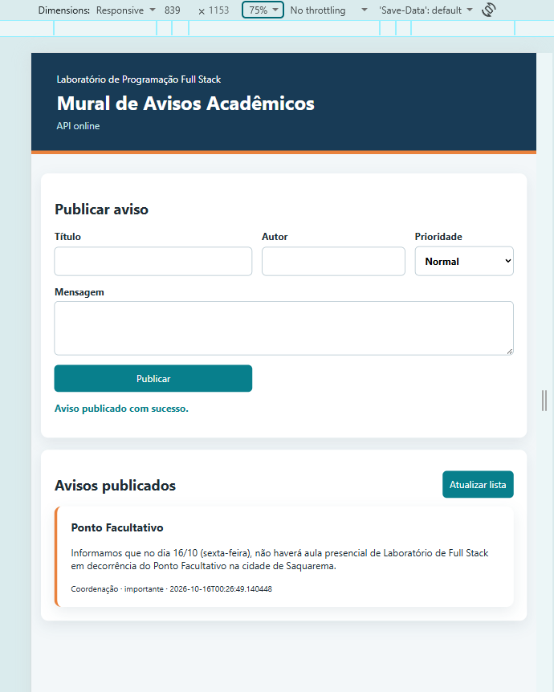
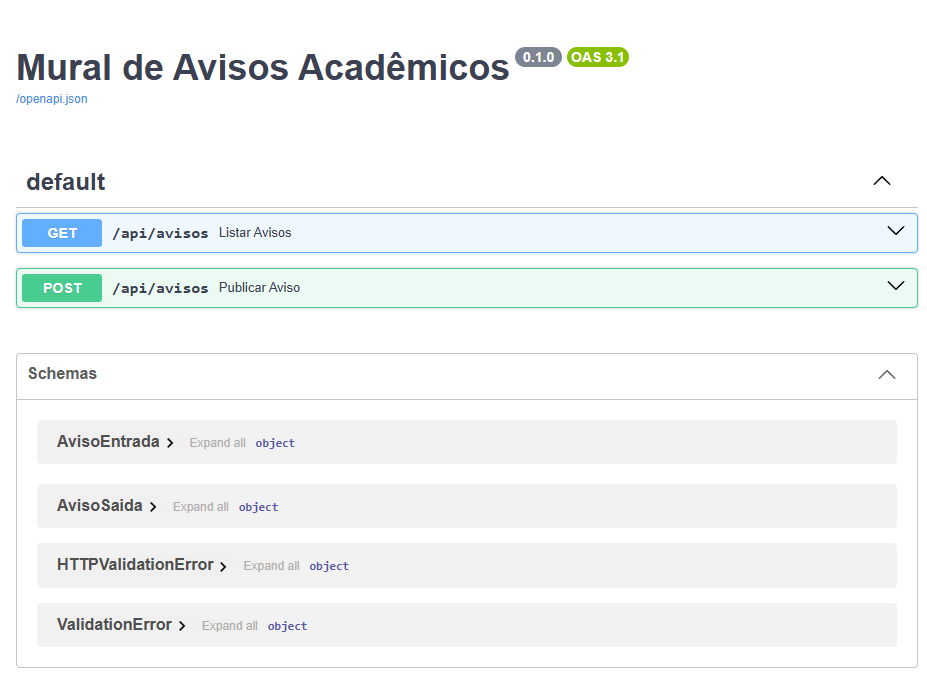
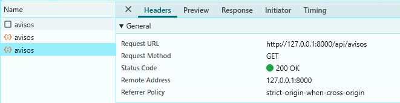
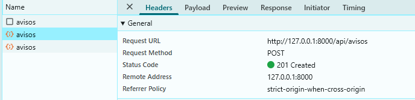
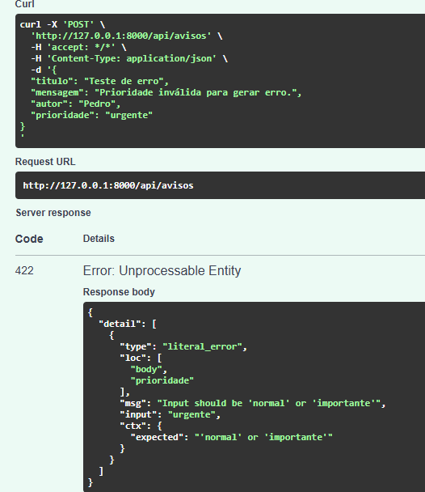

# Atividade Prática Extra – Mural de Avisos Acadêmicos
**Alunos:** Douglas Vignoli, Kaylan Lorete e Pedro Almeida

Back-end em FastAPI para o front-end fornecido (`frontend/`).

## Estrutura
```
atividade_extra/
├── backend/
│   ├── main.py           # app FastAPI, CORS, lista de avisos e rotas
│   ├── models.py         # modelos Pydantic AvisoEntrada e AvisoSaida
│   └── requirements.txt  # dependências
└── frontend/
    ├── index.html
    ├── styles.css
    └── app.js
```

## Como executar
API (terminal 1):
```powershell
cd backend
py -m venv .venv
.\.venv\Scripts\Activate.ps1
python -m pip install -r requirements.txt
uvicorn main:app --reload
```
Se o PowerShell bloquear a ativação da venv, rode antes (vale só para aquele terminal):
```powershell
Set-ExecutionPolicy -Scope Process -ExecutionPolicy Bypass
.\.venv\Scripts\Activate.ps1
```
Front-end (terminal 2):
```powershell
cd frontend
py -m http.server 5500
```
- Front-end: `http://localhost:5500`
- Swagger: `http://127.0.0.1:8000/docs`

## Contrato da API
| Operação | Método e rota | Resposta |
|---|---|---|
| listar avisos | `GET /api/avisos` | 200 e lista JSON |
| publicar aviso | `POST /api/avisos` | 201 e aviso criado (com `id` e `publicado_em`) |

Validações (`models.py`), iguais às do formulário:
| Campo | Regra |
|---|---|
| `titulo` | 4 a 60 caracteres |
| `mensagem` | 10 a 300 caracteres |
| `autor` | 3 a 50 caracteres |
| `prioridade` | só `normal` ou `importante` |

Se algum campo não seguir essas regras, a API responde **422**.

## Testes mínimos
| Caso | Esperado | Obtido |
|---|---|---|
| GET antes de publicar | 200 e lista vazia | ✅ 200 `[]` |
| POST com dados válidos | 201 e objeto com id | ✅ 201 com `id: 1` |
| GET após publicar | 200 e aviso na lista | ✅ 200 com 1 aviso |
| prioridade diferente das opções | 422 | ✅ 422 `Input should be 'normal' or 'importante'` |
| mensagem muito curta ou ausente | 422 | ✅ 422 `String should have at least 10 characters` / `Field required` |

## Evidências

### Interface exibindo um aviso


### Swagger mostrando as duas rotas


### Network: GET 200 e POST 201



### Resposta 422 provocada pelo Swagger
